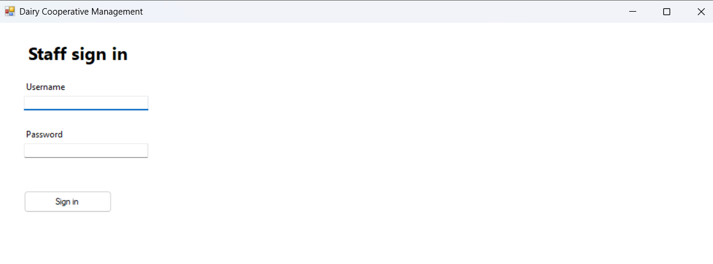
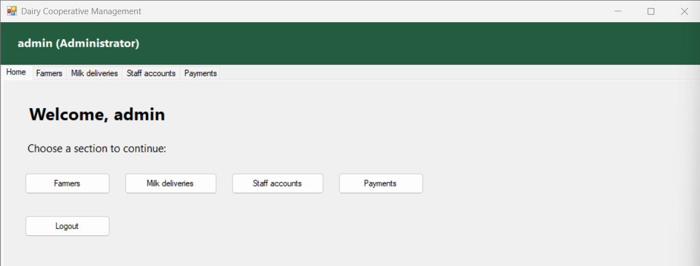
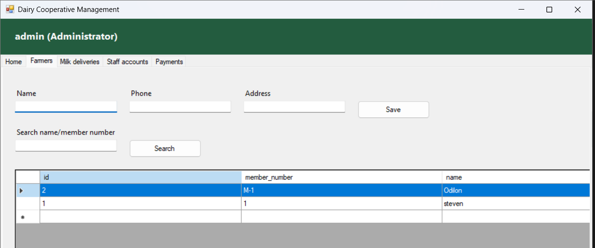
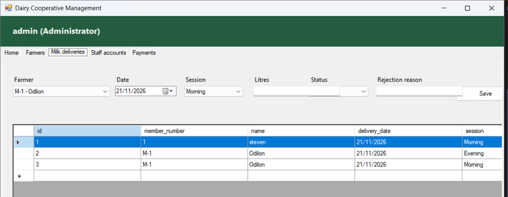

# 🥛 Dairy Cooperative Management

A Windows Forms desktop application for managing a dairy cooperative. The system uses PostgreSQL for data persistence and provides different screens according to the responsibilities of each staff role.

## 📌 Lab 3 requirements

- 🖥️ Windows Forms desktop application
- 🗄️ PostgreSQL database implementation
- 🖱️ Database interaction through a graphical user interface
- 🧩 MVC-oriented application structure
- 👥 Role-based access for administrators, clerks, and treasurers

## 🔐 Staff login

All staff members use the same login page. After successful authentication, the application displays only the pages allowed for the signed-in role. This keeps administrative functions separate from daily operational and payment responsibilities.

_The login page accepts the staff username and password and sends the user to the appropriate role-based home page._

## 👤 User roles and functionality

### 🛠️ Administrator

The administrator manages the cooperative’s master data, staff accounts, deliveries, and payment periods. The administrator can access all application areas because this role is responsible for system-wide management.

#### Administrator home page

_The administrator home page provides navigation to all available sections: Farmers, Milk deliveries, Staff accounts, and Payments._

#### Administrator farmers page

_This page allows the administrator to register and search farmers. Member numbers are generated automatically, while the administrator enters the farmer’s name, phone number, and address._

#### Administrator milk deliveries page

_This page records milk delivered by each farmer, including the date, session, litres, acceptance status, and rejection reason when required._

#### Administrator staff accounts page

_The administrator can create staff accounts and assign the Administrator, Clerk, or Treasurer role. This page is restricted because staff permissions affect access to the rest of the system._

#### Administrator payments page

_The administrator can create payment periods and review payment calculations based on accepted milk deliveries and the configured price per litre._

### 🧾 Clerk

The clerk handles daily cooperative operations. The clerk can manage farmer information and record milk deliveries, but does not manage staff accounts.

#### Clerk farmers page

_The clerk uses this page to register, search, and update farmer information during daily operations._

#### Clerk milk deliveries page

_The clerk records daily morning and evening milk deliveries because this is part of the cooperative’s routine operational work._

#### Clerk payments page

_The clerk can view payment information to support farmer inquiries, while payment-period administration remains restricted to the administrator._

### 💰 Treasurer

The treasurer focuses on payment activities. This role does not need access to farmer registration, delivery entry, or staff-account management, so those pages are hidden after login.

#### Treasurer home page

_The treasurer home page provides focused navigation to the Payments section, matching the role’s financial responsibility._

#### Treasurer payments page

_The treasurer reviews payment calculations and can mark payments as paid with a payment note. This page is the main workspace for the treasurer._

## ✅ Common application features

- 🔑 Password hashing for staff accounts
- 🚪 Logout available to every authenticated user
- 🧭 Home navigation and role-specific menus
- 🧑‍🌾 Automatic member-number generation for new farmers
- 📍 Address values such as `Kigali, Nyarugenge`
- ☎️ Phone-number validation requiring exactly 10 digits
- 🥛 Accepted and rejected delivery tracking
- 💵 Payment-period and payment-status management
- 🔄 Database schema initialization on application startup

## 🧩 MVC architecture

The application separates user-interface, workflow, domain, and persistence responsibilities:

- **View:** `AppForm.cs` contains the Windows Forms screens and user interactions.
- **Controllers:** The `Controllers` folder contains workflow logic such as authentication and farmer operations.
- **Models:** The `Models` folder contains application domain models such as `Farmer`.
- **Data access:** `Database.cs` manages PostgreSQL connections, schema initialization, queries, and commands.

## 🛠️ Technologies

- C#
- Windows Forms
- .NET Framework 4.7.2
- PostgreSQL
- Npgsql 4.1.13
- Visual Studio

## 🚀 Running the application

### Prerequisites

- Visual Studio with .NET Framework 4.7.2 developer tools
- PostgreSQL server running locally or on a configured server
- PostgreSQL credentials with permission to create the application database and tables

### Configuration

1. Copy `App.config.example` to `App.config` if `App.config` does not exist.
2. Edit the `DairyDb` connection string with your PostgreSQL host, database, username, and password.
3. Start the PostgreSQL service.
4. Open `Cyusa_Divince_Lab3.slnx` in Visual Studio.
5. Set `Cyusa_Divince_Lab3` as the startup project.
6. Press **F5**.
7. On the first run, create the first administrator account.

The application initializes the database schema on startup and creates these main tables:

- `staff`
- `farmers`
- `deliveries`
- `payment_periods`
- `payments`

## 🌐 Project repository

[Open the project on GitHub](https://github.com/Cyusa-Divince-27516/Dot_NET_Lab3)

