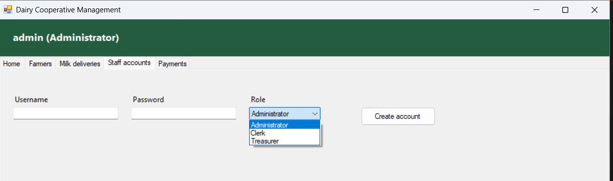
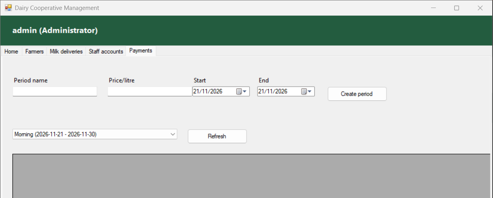
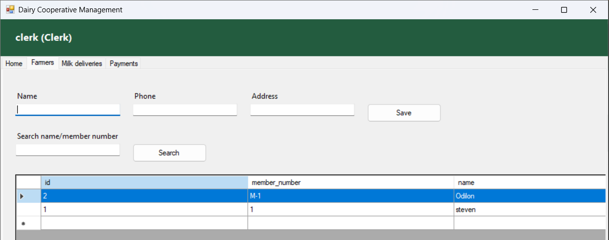
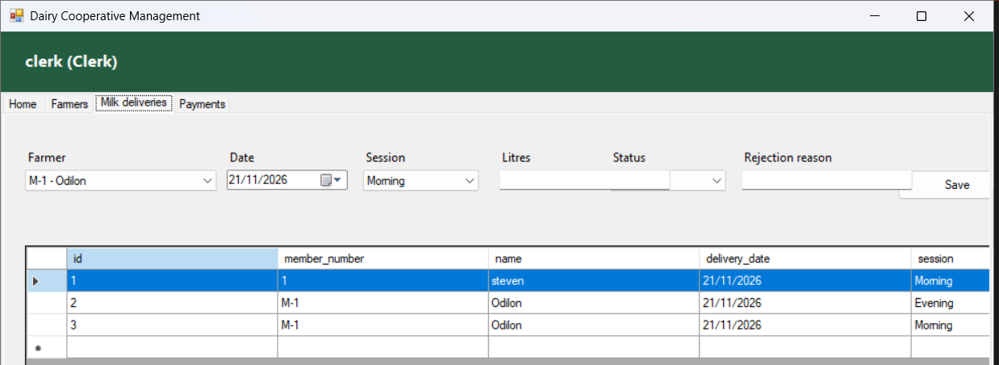
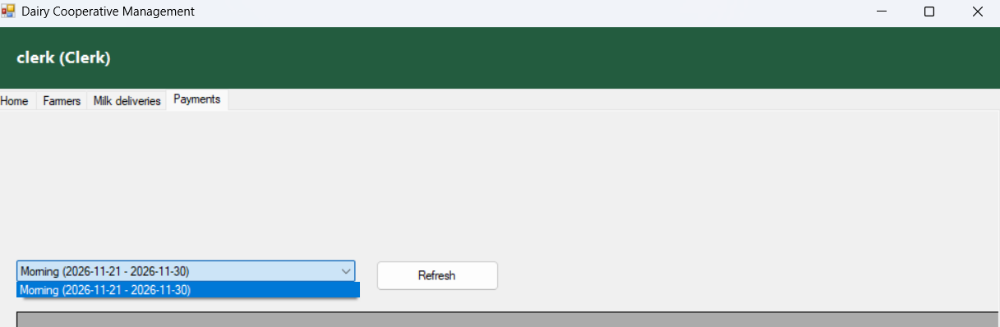
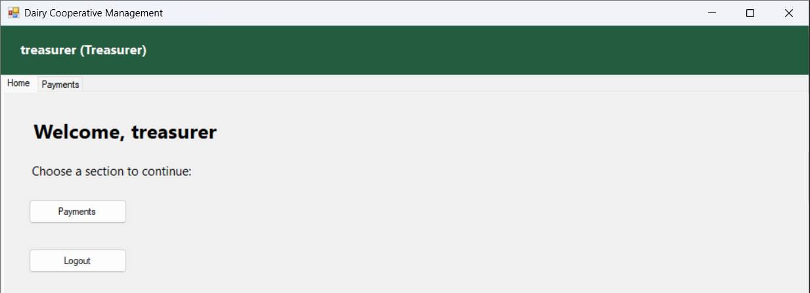
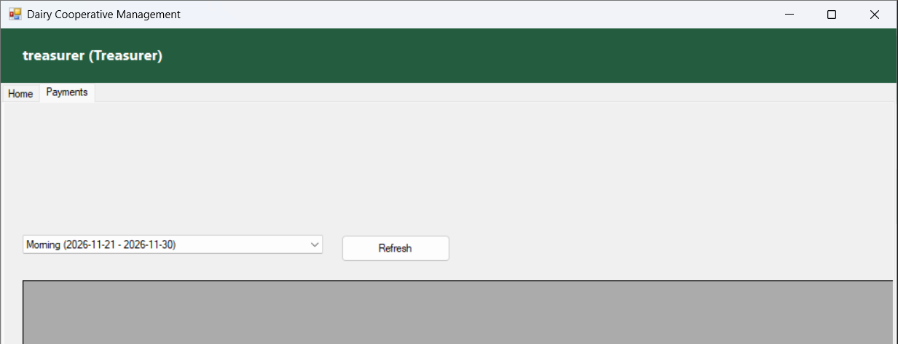

# Dairy Cooperative Management

A Windows Forms desktop application for managing a dairy cooperative. The application uses PostgreSQL for persistence and provides role-based access for administrators, clerks, and treasurers.

## Lab 3 requirements

- Windows Forms desktop application.
- PostgreSQL database implementation.
- Database interaction through a graphical user interface.
- MVC architecture.
- Role-based functionality for administrators, clerks, and treasurers.

## Features

- Staff authentication with password hashing.
- Automatic database and table initialization.
- Automatic member-number generation for new farmers.
- Farmer registration with name, phone, and Rwanda-style address values such as `Kigali, Nyarugenge`.
- Phone-number validation requiring exactly 10 digits.
- Milk-delivery recording for morning and evening sessions.
- Accepted and rejected delivery status tracking.
- Payment-period creation and payment calculation.
- Payment status management.
- Logout for every authenticated user.
- Home navigation and role-specific pages.

## User roles and access

### Administrator

The administrator can access:

- Home page after login.
- Farmers management.
- Milk deliveries.
- Staff accounts.
- Payment periods and payments.
- Logout.

#### Administrator home page

_Add the administrator home-page screenshot at `docs/images/admin-home.png`._

#### Administrator farmers page

_Add the administrator farmers-page screenshot at `docs/images/admin-farmers.png`._

#### Administrator milk deliveries page

_Add the administrator milk-deliveries screenshot at `docs/images/admin-deliveries.png`._

#### Administrator staff accounts page

_Add the administrator staff-accounts screenshot at `docs/images/admin-staff-accounts.png`._

#### Administrator payments page

_Add the administrator payments screenshot at `docs/images/admin-payments.png`._

### Clerk

The clerk can access:

- Home page after login.
- Farmers management.
- Milk deliveries.
- Payments.
- Logout.

#### Clerk farmers page

_Add the clerk farmers-page screenshot at `docs/images/clerk-farmers.png`._

#### Clerk milk deliveries page

_Add the clerk milk-deliveries screenshot at `docs/images/clerk-deliveries.png`._

#### Clerk payments page

_Add the clerk payments screenshot at `docs/images/clerk-payments.png`._

### Treasurer

The treasurer is responsible for payments and can access:

- Home page after login.
- Payments.
- Logout.

#### Treasurer home page

_Add the treasurer home-page screenshot at `docs/images/treasurer-home.png`._

#### Treasurer payments page

_Add the treasurer payments screenshot at `docs/images/treasurer-payments.png`._

## MVC architecture

The application separates user-interface, workflow, domain, and persistence responsibilities:

- **View:** `AppForm.cs` contains the Windows Forms screens and user interactions.
- **Controllers:** The `Controllers` folder contains workflow logic such as authentication and farmer operations.
- **Models:** The `Models` folder contains application domain models such as `Farmer`.
- **Data access:** `Database.cs` manages PostgreSQL connections, schema initialization, queries, and commands.

## Technologies

- C#
- Windows Forms
- .NET Framework 4.7.2
- PostgreSQL
- Npgsql 4.1.13
- Visual Studio

## Prerequisites

- Visual Studio with .NET Framework 4.7.2 developer tools.
- PostgreSQL server running locally or on a configured server.
- PostgreSQL credentials with permission to create the application database and tables.

## Configuration

1. Copy `App.config.example` to `App.config` if `App.config` does not exist.
2. Edit the `DairyDb` connection string with your PostgreSQL host, database, username, and password.
3. Start the PostgreSQL service.
4. Open `Cyusa_Divince_Lab3.slnx` in Visual Studio.
5. Set `Cyusa_Divince_Lab3` as the startup project.
6. Press **F5**.

The application initializes the database schema on startup. On the first run, create the first administrator account.

## Database behavior

The application creates the following main tables when it starts:

- `staff`
- `farmers`
- `deliveries`
- `payment_periods`
- `payments`

New farmer member numbers are generated automatically by PostgreSQL. Existing farmer records are migrated from `village` to `address` when required.

## GitHub submission contents

The repository should include source and project files required to build the application, including:

- C# source files.
- MVC model and controller files.
- `.csproj` and `.slnx` files.
- `App.config.example`.
- `lib/Npgsql.dll` and required runtime assemblies.
- README documentation and screenshots under `docs/images/`.

Generated build files and local credentials are excluded through `.gitignore`. Do not commit the local `App.config` file or database passwords.

## Repository

[GitHub repository](https://github.com/Cyusa-Divince-27516/Dot_NET_Lab3)

